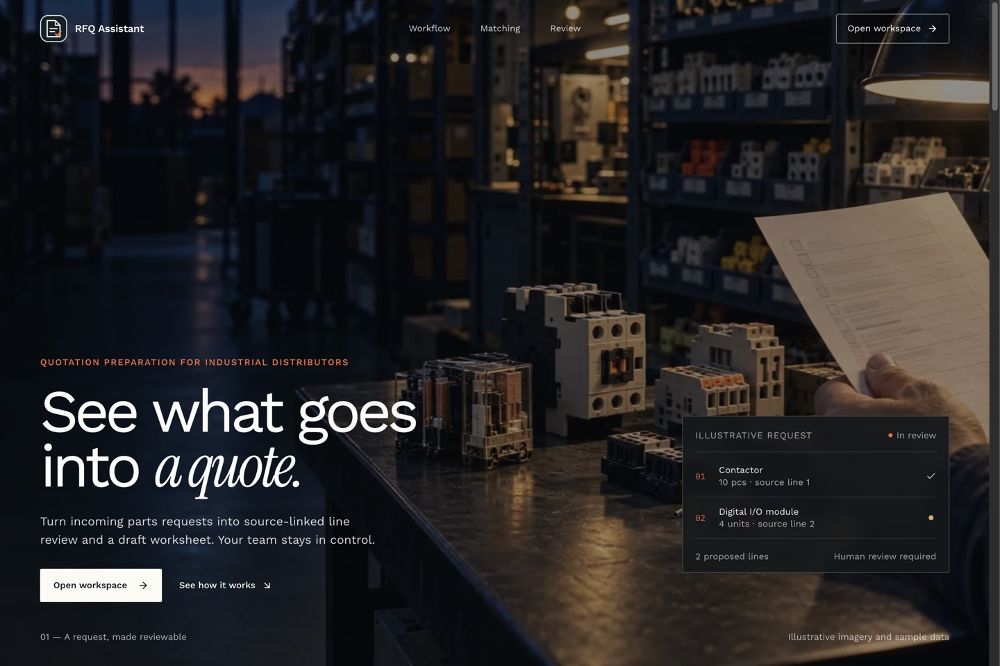
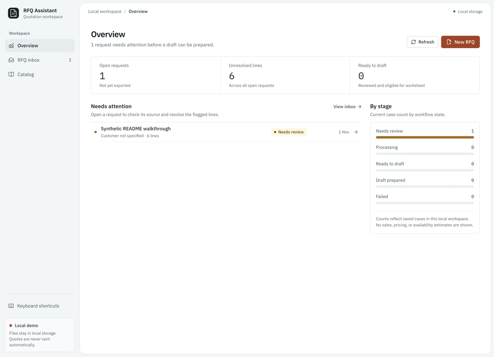
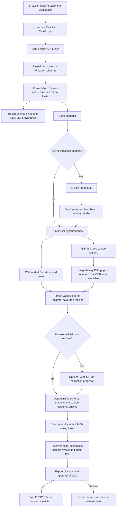
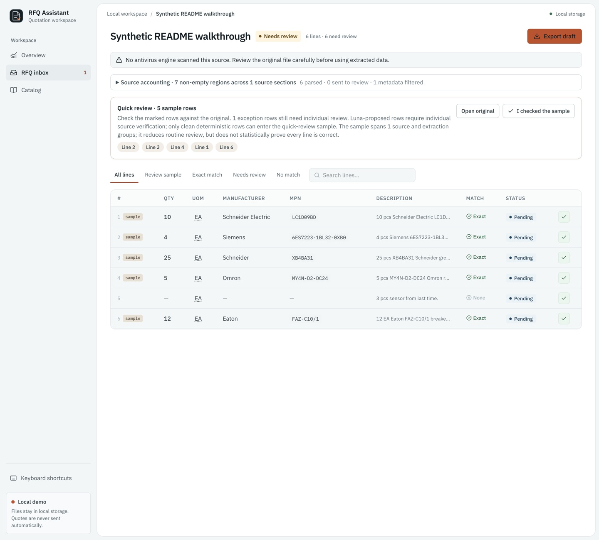
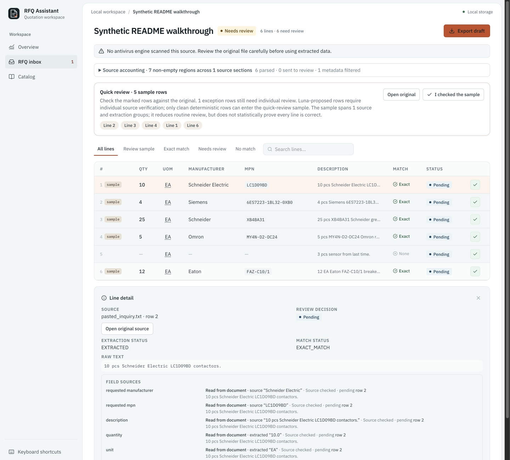
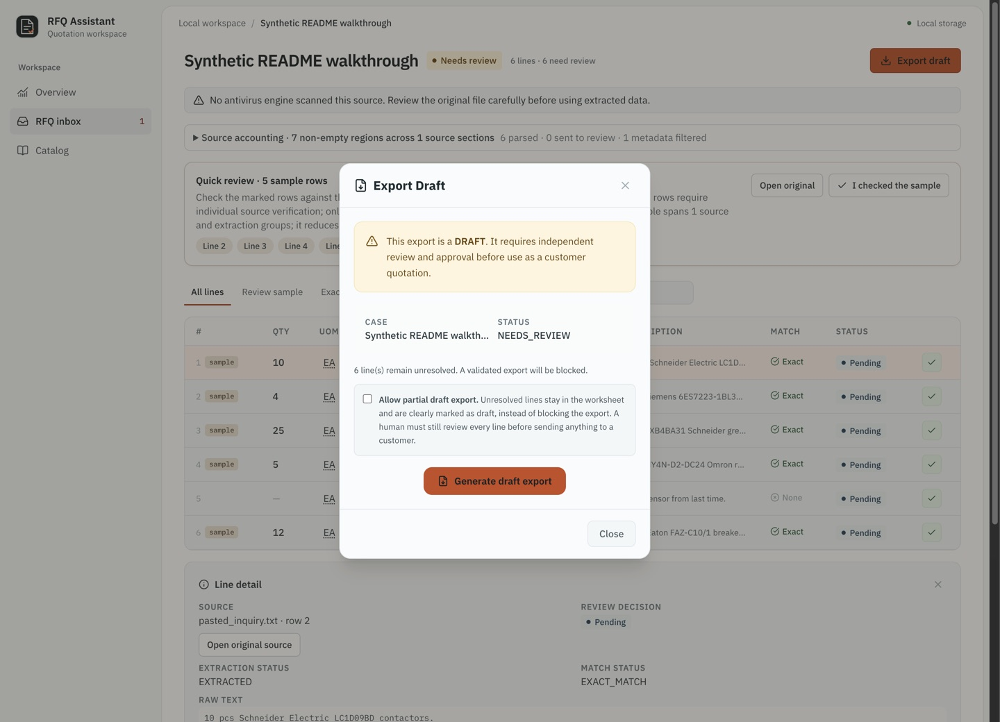

# RFQ Assistant

<p align="center">
  
  <br /><strong>Human-reviewed quotation preparation</strong>
</p>

<p align="center">
  <a href="https://github.com/ayushcodes13/RFQ-Assistant/actions/workflows/ci.yml"></a>
  <a href="https://github.com/ayushcodes13/RFQ-Assistant/actions/workflows/codeql.yml"></a>
  <a href="https://github.com/ayushcodes13/RFQ-Assistant/actions/workflows/secret-scan.yml"></a>
  
  
</p>

<p align="center"><a href="#the-proposed-experience">Workflow</a> · <a href="#architecture">Architecture</a> · <a href="#current-synthetic-verification">Testing</a> · <a href="#running-locally">Run locally</a></p>

RFQ Assistant is a working local prototype for independent industrial component distributors. It turns pasted email, PDF, XLSX, and CSV requests into source-linked line items for human review and draft worksheet export.

It is a single-user local prototype, not a production-ready multi-tenant service. Screenshots below use synthetic RFQ data; landing imagery is illustrative. They do not prove customer demand, extraction accuracy, time savings, or ROI. Do not upload real customer RFQs without an approved data-handling plan.

<p align="center">
  
</p>
<p align="center"><em>Landing page · illustrative artwork and sample data</em></p>

## The problem we are testing

A distributor receives an RFQ through an email, PDF bill of materials, spreadsheet, or typed part-number list. A salesperson reads the request, separates its line items, checks the company's item catalog, resolves ambiguities, and manually drafts a reply. We hypothesize that the repetitive, document-heavy steps consume enough time to justify a paid workflow assistant. Actual pain, frequency, existing systems, and willingness to pay **must be confirmed directly with buyers**.

## The proposed experience

    Buyer sends PDF / XLSX / email
                   |
                   v
            Upload / paste RFQ
                   |
                   v
       Extract lines + source evidence
                   |
                   v
      Match known SKUs / flag unknowns
                   |
                   v
          Salesperson reviews edits
                   |
                   v
       Export quote worksheet + draft
                   |
                   v
       Human sends through normal tools

**Never auto-send a quote. Never invent part numbers, prices, technical equivalence, inventory, or lead time.**

### The workspace starts with a clear queue

The overview shows open requests, lines that still need review, and cases ready for draft preparation. It gives the operator a starting point without presenting inferred sales or availability figures.

<p align="center">
  
</p>
<p align="center"><em>Overview · one synthetic request awaiting review</em></p>

## Architecture



Parsing, matching, review state, and export checks stay separate. Luna may propose missing or unclear fields; it cannot certify a line, approve a quote, or send anything.

### Libraries and why

| Area | Library or tool | Why it is used |
| --- | --- | --- |
| Browser app | Next.js 16, React 19, TypeScript 5 | Page routing, server-side same-origin API proxy, typed UI. |
| UI styling and interaction | Tailwind CSS 4, CSS, Framer Motion, Lucide React | Layout and restrained landing motion; consistent interface icons. |
| API | FastAPI, Starlette, Pydantic 2 | HTTP endpoints, CORS middleware, strict request/response schemas, OpenAPI generation. |
| CSV | Python standard-library `csv` | Parse rows without adding a dependency. |
| XLSX | `openpyxl`, `defusedxml` | Read workbook cells, formulas, sheets, and source coordinates; defend XML parsing. |
| PDF | `pypdf`, PyMuPDF | Read native PDF text; inspect and render selected image-heavy pages. |
| OCR | Local Tesseract (optional executable) | OCR only selected sparse image-heavy pages; no external OCR call by default. |
| Legacy XLS | LibreOffice (optional executable) | Convert legacy workbooks in a bounded, isolated subprocess when available. |
| Optional LLM fallback | `httpx` to configured GPT-6 Luna endpoint | Propose unresolved fields; strict schema, numeric grounding, verbatim evidence, and a second consistency pass remain in Python. |
| Matching | Project exact matcher; RapidFuzz for candidate search | Exact manufacturer and MPN controls the match. Fuzzy similarity only helps locate candidates. |
| Persistence and jobs | Python `sqlite3`, SQLite state store | Durable local cases, audit events, catalog snapshot, and single-host ingestion queue. |
| API contract | `openapi-typescript` | Generate frontend request/response types from the checked-in backend OpenAPI schema. |
| Tests | pytest, Hypothesis, Playwright | Backend and property tests, plus browser-level workflow checks. |

SQLite and its worker are local, single-host prototype infrastructure. A customer pilot needs authenticated tenant isolation, private storage, retention rules, and supervised deployment before real RFQ data is used. See [the detailed architecture](docs/ARCHITECTURE.md).

## First product slice

### Review extracted lines

Paste email text or add a CSV, XLSX, or PDF. The app produces editable, source-linked rows with quantity, unit, manufacturer, part number, description, and extraction warnings. A small distributor catalog is used for exact manufacturer and part-number matching; similar descriptions never establish interchangeability.

<p align="center">
  
</p>
<p align="center"><em>Review table · exact matches are distinct from the unresolved line</em></p>

### Keep evidence with each value

Missing or conflicting fields, duplicates, no-match lines, and possible equivalents stay flagged for review. Opening a row shows source location, raw text, and field-level evidence; edits and approvals are recorded in the case history.

<p align="center">
  
</p>
<p align="center"><em>Line detail · source text and field-level evidence</em></p>

### Export a draft only

After review, an operator can create a quote-preparation XLSX/CSV and unsent email text. Unresolved rows block a validated export. A partial draft requires explicit opt-in and remains labeled for human review.

<p align="center">
  
</p>
<p align="center"><em>Draft export · unresolved lines block validated output</em></p>

Use one component family for the initial benchmark; do not attempt a universal industrial search engine in v0.

## Who it is for

Small independent US/UK industrial electrical, automation, or electronic component distributors (ideally 5–50 people; evaluate up to 100) with manual quotation intake and a real inside-sales desk. Their website accepting RFQs is **qualification evidence**, not proof of purchasing intent.

## Repository guide

| File | Purpose |
| --- | --- |
| [AGENTS.md](AGENTS.md) | Instructions for coding agents and mandatory PR workflow |
| [docs/PRODUCT.md](docs/PRODUCT.md) | Mission, user needs, functional boundaries, success criteria |
| [docs/SCENARIOS.md](docs/SCENARIOS.md) | Realistic illustrative workflows and expected human reactions |
| [docs/UX.md](docs/UX.md) | Screens, states, wireframes, interaction and visual design |
| [docs/ARCHITECTURE.md](docs/ARCHITECTURE.md) | Lean architecture, contracts, data and security constraints |
| [docs/ROADMAP.md](docs/ROADMAP.md) | Ordered build checkpoints and definition of done |
| [docs/TESTING.md](docs/TESTING.md) | Ground-truth, adversarial and end-to-end test plan |
| [docs/VALIDATION.md](docs/VALIDATION.md) | Buyer interviews, commercial experiments, outreach guardrails |
| [docs/DECISIONS.md](docs/DECISIONS.md) | Decisions, assumptions, open risks and pivot conditions |
| [SECURITY.md](SECURITY.md) | Safe handling and disclosure guidance |

## Build status

- [x] Product scope, design and build checklist documented
- [ ] Buyer conversations confirm the narrow bottleneck *(Pending commercial agreements; proceeding with synthetic validation)*
- [x] Synthetic sample pack and ground truth created *(Phase 1 complete in PR #2)*
- [x] Upload and parser working locally *(Phase 2 complete in PR #3)*
- [x] Catalog matching and review UI working locally *(Phase 3 & 4 complete in PR #4 & #6)*
- [x] Tested quotation worksheet and export *(Phase 5 complete in PR #5)*
- [x] Independent realistic end-to-end demo *(All 7 scenarios verified in PR #7)*
- [ ] One opt-in customer pilot with measured baseline *(Phase 6 pilot readiness)*

### Current synthetic verification

Latest local run on Python 3.12 and Node.js: **468 backend tests passed**; the
synthetic 20-line scorecard detected all 20 lines and passed 80/80 critical
field checks plus 20/20 exact catalog checks; the 30-document corpus passed
all 180 critical field checks across CSV, PDF, text, and XLSX; the 128-request
concurrency check created 128 unique cases; and all 12 Playwright workflows
passed. Frontend lint, generated API type check, production build, and backend
Ruff syntax checks passed. The backend suite emitted deprecation warnings from
dependencies and existing `datetime.utcnow()` calls. These are local synthetic
checks, not customer accuracy, production reliability, or performance claims.

## Running locally

For a clean local demo, install dependencies once, then use the isolated launcher:

```bash
python3 -m venv .venv
source .venv/bin/activate
pip install -e '.[test]'
cd frontend && npm ci && cd ..
./scripts/demo.sh
```

The landing page opens at `http://localhost:3010/`; the review workspace opens at
`http://localhost:3010/workspace`. Stop the demo with `./scripts/demo.sh stop`.

### 1. Backend (FastAPI + Python 3.10+)
```bash
source .venv/bin/activate
pytest -q

# Start backend server on port 8000 (preloads synthetic catalog automatically)
uvicorn rfq_assistant.api.app:app --host 127.0.0.1 --port 8000
```

### 2. Frontend (Next.js + TypeScript)
```bash
cd frontend
npm ci
npm run check:types  # Fail if generated OpenAPI types are stale
npm run build        # Verify typecheck and production build
npm run e2e          # Full-stack Playwright happy path (starts backend + Next)
npm run dev          # Starts web app at http://localhost:3000
```

Frontend wire types come from the backend OpenAPI schema. After changing API
models, regenerate and commit both files:

```bash
python -m rfq_assistant.scripts.export_openapi
cd frontend && npm run gen:types
```

The browser talks to the same-origin Next.js API proxy. Configure
`RFQ_ASSISTANT_API_URL` and, when the backend requires it,
`RFQ_ASSISTANT_API_KEY` in the **server environment only**; never use a
`NEXT_PUBLIC_` variable for credentials. This proxy does not provide user or
tenant authentication: the local demo is single-user, and a shared API key is
not sufficient authorization for a distributor pilot.

<details>
<summary>Advanced Luna provider settings</summary>

When enabling the optional Luna fallback, `RFQ_LLM_DEPLOYMENT_VERSION` may be
set to an immutable provider deployment revision to enable retry-safe caching
of validated model results. If the provider offers only a mutable model alias,
leave this unset; deterministic parse/OCR retry caching still works.
Set `RFQ_LLM_TIMEOUT_SECONDS` to bound each provider request (default 12),
`RFQ_LLM_MAX_ATTEMPTS` to bound transport retries (default 2, maximum 3), and
`RFQ_LLM_RETRY_BASE_SECONDS` / `RFQ_LLM_RETRY_MAX_DELAY_SECONDS` to control
transient-error backoff (defaults 0.2 / 2 seconds). Only timeouts, HTTP 408,
429, and 5xx are retried; permanent errors and malformed responses are not.
If a provider's `Retry-After` is longer than the configured maximum, the call
fails promptly and unresolved fields go to human review instead of waiting
through a long quota pause.
The reused Luna client applies process-local concurrency limits and a circuit
breaker. Set `RFQ_LLM_REDIS_URL` and install `pip install -e '.[production]'` to enable atomic
request-start pacing shared across worker processes; `RFQ_LLM_SHARED_PACE_PREFIX`
can separate provider quotas (default `{rfq-luna}:provider`). A shared 429
`Retry-After` hold pauses other workers using that prefix. Redis calls have
short socket timeouts and fall back to process-local pacing during an outage,
so configure a Redis health alert before relying on the global quota. Without
the URL, pacing remains process-local. Configure `RFQ_LLM_MAX_CONCURRENT_REQUESTS`
(default 2), `RFQ_LLM_REQUESTS_PER_MINUTE` (default 60),
`RFQ_LLM_CIRCUIT_FAILURE_THRESHOLD` (default 4),
`RFQ_LLM_CIRCUIT_OPEN_SECONDS` (default 30), and
`RFQ_LLM_ADMISSION_TIMEOUT_SECONDS` (default 10). If either provider gate
rejects a call, the affected extraction goes to human review. Global pacing is
shared when Redis is configured; concurrency limits and the circuit breaker
remain process-local and require separately coordinated deployment settings.

</details>

Open `http://localhost:3000` for the product landing page and `http://localhost:3000/workspace` for the RFQ workspace. The workspace supports RFQ intake, line-level provenance review, catalog browsing, approval, and draft worksheet export.

### Client demo

For a clean, predictable demo, start both applications with the isolated demo launcher:

```bash
./scripts/demo.sh
```

It starts the API with synchronous ingestion, serves the workspace at
`http://localhost:3010/workspace`, and uses a fresh SQLite database and file
storage under `.demo-runtime/`. This reset does not delete or change `storage/`
or its existing RFQs. The launcher refuses to use occupied ports; choose
alternates with `RFQ_DEMO_BACKEND_PORT` and `RFQ_DEMO_FRONTEND_PORT`. Stop only
the processes started by this script with `./scripts/demo.sh stop`. Synthetic
drag-and-drop examples are in `demo-data/` (email text, PDF, and XLSX). The
catalog is preloaded from `fixtures/catalogs/` in a fresh demo database.

### Legacy workbook security boundary

For local synthetic work, legacy `.xls` may be converted with bounded
LibreOffice. When `REQUIRE_AUTH` or `REQUIRE_ANTIVIRUS` is enabled, the
application rejects `.xls` conversion: a timeout and reduced subprocess
environment are not an OS/container sandbox. Ask the distributor to convert
the workbook in its own isolated office environment and upload `.xlsx`.
Supporting protected legacy conversion requires a separately isolated worker.

### Workspace authentication boundary

Anonymous browser access is allowed only in the **local development demo**
when no privileged server API key or workspace credentials are configured.
In a production Next.js server, or whenever `RFQ_ASSISTANT_API_KEY` is set,
the Next.js proxy is fail-closed until both of these server-only variables exist:

```bash
RFQ_WORKSPACE_PASSWORD=<a-unique-high-entropy-password-at-least-16-characters>
RFQ_WORKSPACE_SESSION_SECRET=<an-independent-random-secret-at-least-32-characters>
```

Operators visit `/login`. The proxy checks a signed, eight-hour,
HTTP-only, same-site cookie on every request. In production, the cookie
requires HTTPS. The login endpoint has a local ten-attempts-per-minute guard.

**This is a single-operator/single-workspace protection layer, not a
multi-user or multi-tenant identity and authorization system.** All authenticated
visitors still share the backend API-key identity. For an external customer
pilot, also require protected backend authentication, loopback/private API
network access, a shared trusted-edge login limiter, actual per-user identities,
tenant ownership checks and a reviewed retention policy. Do not expose the
backend or this one-password workspace to unrelated distributors.

### Local intake protection

The FastAPI process admits up to `RFQ_MAX_INTAKES_PER_MINUTE` (default 240)
expensive POST requests per 60-second rolling window across RFQ uploads,
catalog imports and the v1 extraction endpoint. Excess requests receive HTTP 429
with `Retry-After` before the application reads and processes their upload.
This is a **single-process resource guard**, not tenant throttling or a
distributed security boundary. Customer deployment requires authenticated
ingress and an edge/shared rate limiter; set a smaller operational cap only
after representative workload testing.

### Local persistence

The API stores RFQ cases, extracted lines, audit events, and the imported catalog
in `storage/rfq_assistant.sqlite3`; uploaded source files and generated exports
remain under `storage/`. These local files are ignored by Git. Set
`RFQ_ASSISTANT_DB_PATH` to place the SQLite database elsewhere. This supports
restart recovery for a single local/demo workspace; it does not provide
production backup, encryption, tenant isolation, or a customer data-retention
policy.


## Engineering principles

**Small, inspectable, fail-closed, privacy-aware.** Prefer deterministic extraction of IDs/quantities and exact catalog matching over fancy agents. Use models only where document layout or language extraction needs them. Each output shows a source and allows correction. Make it obvious when the system does not know.

**Ownership:** Personal project only. Do not transfer any employer-owned code, credentials, datasets, repositories or contacts.

## Development workflow

Every change to application code, documentation or configuration happens on a feature branch and is proposed to **main through a pull request**. Follow [AGENTS.md](AGENTS.md). After a PR is successfully merged, its feature branch should be deleted; the repository includes a best-effort same-repository branch cleanup workflow.

## License

No open-source license has been selected. Public visibility does **not** grant reuse permission. Choose a license explicitly before external code contributions.
