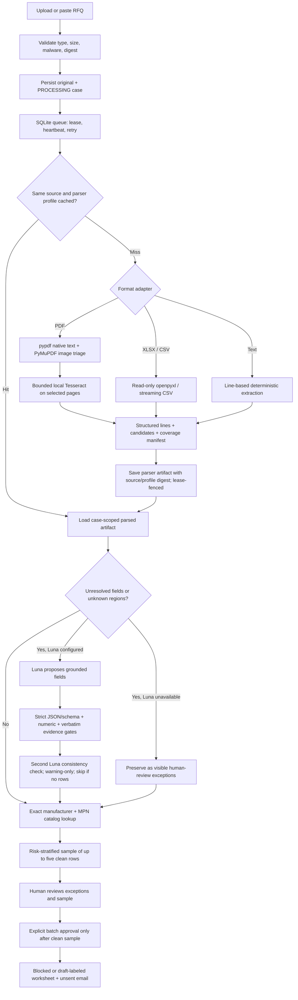
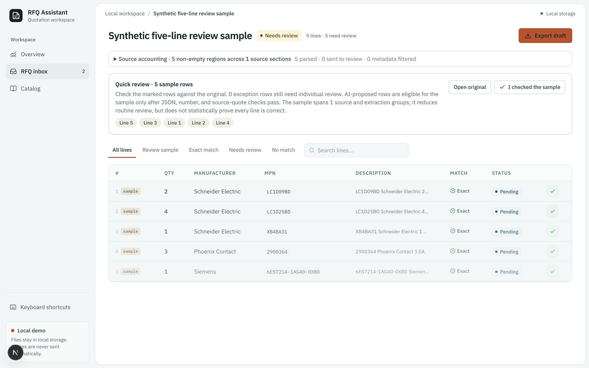

# Advanced ingestion architecture: RFQ adaptation

This note records the backend patterns worth applying to RFQ Assistant, what the
current code already does, and what still needs to change. It describes the
reference project's ideas at an architectural level; its code, credentials, and
data are not copied into this product.

## RFQ workflow today

Synthetic browser review of the coverage summary and five-row worklist:

The deterministic path is deliberate; this does not mean the product avoids
LLMs. A workbook cell under a recognized `Quantity` heading is already
structured evidence, so re-asking a model to read it usually adds latency and
cost without adding information. Luna is used for unresolved or unfamiliar
layouts, then strict JSON/schema validation checks output shape, numeric and
unit grounding checks every proposed quantity against its quoted evidence, and
verbatim checks require field values to occur in the cited source excerpt. A
second Luna pass looks for conflicts but can only add a warning; it cannot
approve. Invalid JSON receives at most one repair request, after which
uncertainty goes to the reviewer. Exact manufacturer+MPN matching and export
blocking are deterministic safety gates. Quantity text is parsed as a decimal,
checked against the source quote, then rejected if the application's numeric
representation would overflow or change that value. Human review remains the
final authority; the five-row sample reduces attention on clean rows but is not
a statistical accuracy guarantee.

## Patterns to transfer

| Engineering pattern | RFQ fit | Current state | Work still needed |
|---|---|---|---|
| Extract once into versioned, reusable document artifacts | Avoid redoing expensive parsing/OCR/model work after retries or case reopen | Deterministic parse/OCR and validated Luna results are zlib-compressed and cached per case by source digest and complete parser/model profile; Luna caching is enabled only when `RFQ_LLM_DEPLOYMENT_VERSION` pins an immutable revision; raw payloads are capped at 10 MiB, writes are lease-fenced, and case deletion cascades to artifacts | Extend reuse across cases only after workspace/tenant identity and retention are real; verify the provider’s deployment versioning contract before enabling the pin in production |
| Page-level PDF triage and bounded OCR | Spend CPU/OCR only on pages likely to need it; make failures visible | Native text uses pypdf to preserve RFQ row grouping; PyMuPDF estimates image coverage; local Tesseract has a 10-page/document cap and two-page concurrency; manifests persist rotation, per-page counts/hashes, empty state, and OCR decision/outcome including failures; case records parser version/profile | Add rotated/scanned synthetic fixtures that verify OCR text against the displayed source orientation; add sanitized per-page render/OCR timing outcomes |
| Structured Excel ingestion without interpreting formulas as facts | Preserve identifiers and quantities while preventing workbook calculations from becoming trusted inputs | openpyxl reads streaming formula and cached-value views; simple zero-padded numeric identifiers retain displayed leading zeroes; numeric part numbers beyond Excel's 15-digit precision are flagged; formula-backed values show stored cached results only when present and label them not recalculated; formula-backed quantity remains unresolved; manifests include header row, formula count, hidden/empty sheet status, row/column limit state, disposition counts, and hashes | Add stronger formula-to-line field receipts and parser-version provenance |
| Versioned processing and fenced worker writes | Prevent stale retries from overwriting newer work | SQLite queue uses claim leases, heartbeat, bounded retries/backoff, and fenced snapshots | Keep this for local single-host use; production needs a shared queue/store adapter, worker supervision, dead-letter visibility, and tenant-aware idempotency |
| Bound concurrency and expensive stages | Keep OCR/model work from overwhelming the process and expose latency contributors | Two concurrent ingestion workers; PDF OCR capped at two pages; LLM input bounded; parse/OCR reuse on same-case retries; one reused Luna client applies per-process request pacing, concurrent-call bounds, and a transient-failure circuit breaker; transport retries transient timeout/408/429/5xx responses at most once by default with capped backoff and short Retry-After support; malformed responses and permanent HTTP errors are not retried; queue wait for each ready job attempt, stage timings, and token/call telemetry are persisted without RFQ text | Add per-stage OCR, extraction, validation, and persistence outcome metrics; replace local provider controls with a shared limiter/breaker and coordinate global model/OCR budgets across workers before multi-host production |
| Model-assisted interpretation with deterministic checks | Recover unfamiliar input without trusting model output | Luna-only optional adapter; strict Pydantic JSON, source quote/field verbatim checks, numeric/unit grounding, one repair attempt, second warning-only consistency call; case stores model, deployment pin, prompt hash, schema and validator versions, call/repair/review counts, stage time, and tokens when reported | Verify provider deployment immutability guarantees and evaluate cache-hit behavior on a labeled retry corpus |
| Reduce human effort through risk-based sampling | Review a few representative clean rows while keeping ambiguous rows visible | Up to five clean rows are sampled across extraction path and source location; the UI states the sampled strata and that this is not a statistical guarantee; exceptions stay individual; a correction disables batch approval | Validate the workload/error tradeoff on held-out, customer-approved RFQs before using this as a production approval policy |

## Why not copy every reference behavior

Some reference behaviors serve conversational search across long financial
documents, rather than extracting RFQ line items. In particular, LLM summaries
of every worksheet can multiply model calls and delay a quote request. RFQ
Assistant should keep full row structure and source coordinates, summarize only
when a measured operator task benefits, and avoid paying for model work on rows
the parser can read exactly. Likewise, a Redis-backed multi-host queue belongs
in the production deployment milestone; the local SQLite queue is simpler and
already has the right lease/fencing concepts for this prototype.

## Read-only reference audit and RFQ-specific adaptation

The reference PDF workflow is a document-indexing pipeline: it extracts text
per page, classifies visual pages in a reusable process pool, OCRs only flagged
pages in bounded batches, records per-stage timings and OCR failure/cost
counters, and stores page text, visual tags, and OCR word geometry as separate
versioned artifacts. Its Excel workflow keeps formula and cached-value views,
preserves worksheet structure, creates a compact workbook catalog, and runs
sheet summaries concurrently with a cap. The worker layer adds leased queue
claims, heartbeats, recovery, bounded CPU slots, shared provider pacing, and a
circuit breaker around remote model calls.

RFQ Assistant now adapts the pieces that protect quote correctness and reduce
repeat work: dual Excel views, displayed numeric identifier formatting,
review-only cached formula values, page-selective bounded local OCR, case-scoped
versioned parse/model artifacts, worker leases, stage/token telemetry, and a
single reusable Luna HTTP client with bounded transient retries. The parser
does not cap an RFQ worksheet to a short summary window: every row inside the
validated workbook limits is accounted for because dropping a requested line
would be a safety defect. Local Tesseract is retained instead of adding a
remote OCR provider, which avoids a new processor/data-transfer dependency and
cloud page charges in the prototype. The current SQLite worker and provider
gate are single-process/single-host controls; they do not replace the
reference's distributed rate limiter or circuit breaker and must not be
presented as production multi-host controls.

```mermaid
flowchart LR
    U[RFQ file or pasted text] --> V[Validate and retain original]
    V --> Q[Durable local queue + fenced worker]
    Q --> P[Format parser + source coverage]
    P -->|PDF image-heavy pages| O[Bounded local OCR]
    P -->|Structured rows| D[Deterministic field extraction]
    O --> C[Candidates + provenance]
    D --> C
    C -->|All required fields grounded| M[Exact manufacturer + MPN match]
    C -->|Unclear fields or regions| L[Luna: propose JSON]
    L --> S[Schema + number/unit + verbatim checks]
    S -->|Valid| R[Luna consistency review]
    S -->|Invalid after one repair| H[Individual human exception]
    R -->|Conflict, uncertainty, provider failure| H
    R -->|Consistent| M
    M --> W[All exceptions + up to five clean sample rows]
    W -->|Sample passes| A[Explicit batch approval available]
    W -->|Sample corrected| H
    A --> E[Draft export only; never auto-send]
    H --> E
```

## Production-quality work still required

1. **Coverage manifest closure:** the implementation aggregates observed
   non-empty regions and records empty page/sheet state, OCR decision/outcome,
   PDF rotation, detected header row, hidden-sheet status, formula-backed fields,
   and explicit limit/parser-failure state. Continue with per-row disposition
   reconciliation, hidden row/column coverage, and rotated-image OCR fixtures. A failure or
   cap must never disappear from the report or permit the clean-row batch path.
2. **Processing provenance:** the case now saves a parser version and parser/OCR profile hash,
   prompt hash, schema and validator versions, model label, call/repair/review counts, stage
   durations, and token totals when the provider reports usage. A pinned provider
   deployment version is required for model-result caching. Add queue-wait and
   retry-count measurements to case telemetry, and preserve sanitized provider
   outcome labels without request or source text.
3. **Retry-safe derived artifacts:** parser/OCR results are cached per case by
   source digest and parser/OCR profile; a retry with the same profile reuses
   them, and a changed digest/profile cannot hit. Extend to workspace-scoped
   reuse only after tenant identity and retention controls exist. Oversized
   derived artifacts are skipped rather than allowed to grow without a bound.
   Cache validated Luna results only when the deployment version is explicitly
   pinned and that key also includes model, prompt, schema, validator, and exact
   source segments.
4. **Human effort policy:** keep all uncertain, OCR-derived, guessed-layout,
   formula-backed, collision, and missing-field rows as individual exceptions.
   Sample at most five otherwise-clean rows across meaningful strata. If a
   sample needs correction, expand review to the affected stratum (or all clean
   rows when the scope cannot be safely determined); never batch-approve the
   remainder on a failed sample.
5. **Production worker boundary:** replace SQLite/local filesystem with a
   durable shared queue, private object storage, authenticated tenant-aware
   persistence, worker isolation for LibreOffice/OCR, resource limits, backup,
   monitoring, retention, and deletion controls before a real customer pilot.

## Acceptance evidence for the end-to-end target

- A corpus that varies page rotation, native/scanned/mixed PDFs, repeated table
  headers, multiple/hidden/formula-heavy sheets, blank/title rows, unfamiliar
  headers, and text RFQs; every nonempty source region reconciles to the manifest.
- Mutations to model JSON (wrong type, missing/duplicate line, invented number,
  quote mismatch, wrong source locator, invalid unit) are rejected or become a
  visible exception; malformed second-pass output never approves.
- Repeated jobs, expired leases, worker crashes, and changed source/model
  versions prove that cached artifacts are reused only when safe and stale
  writes cannot win.
- The UI shows concise counts for clean rows, exceptions, sampled rows, source
  coverage, and model/OCR warnings. A reviewer can navigate each item back to
  its original page/sheet/row and exports remain blocked until policy passes.
- Report extraction recall, critical-field exactness, unflagged critical error
  count, coverage, correction burden, and review time separately. Five sampled
  rows are a workload control, not proof of a statistical accuracy rate.
