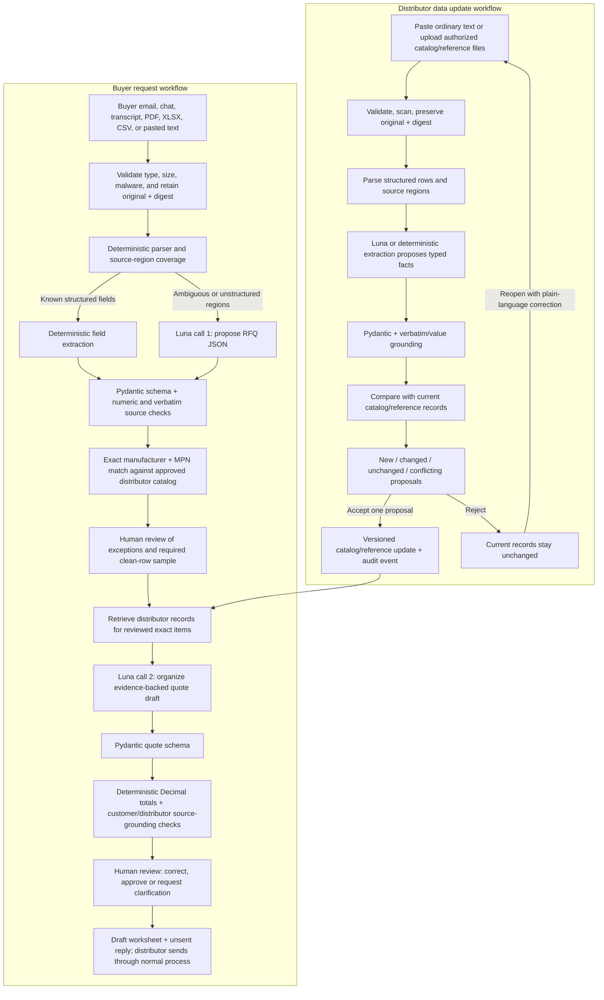
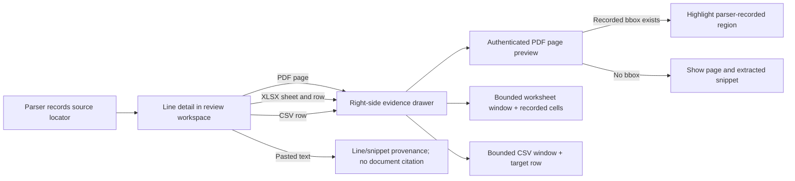

# RFQ Assistant technical architecture

This file describes the current local prototype and its safety boundary. Its SQLite worker is single-host prototype infrastructure; production deployment still needs shared durable storage and worker operations.

## Expanded target workflow (implementation in progress)

The product has two operator entry points: **New customer request** and **Update distributor data**. They share source validation, durable source references, the bounded Luna provider, strict Pydantic schemas, source-grounding checks, and an audit trail. They have separate domain workflows so buyer claims cannot overwrite distributor facts and distributor updates cannot rewrite an existing RFQ silently.



The RFQ intake, staged catalog updates, and bounded quote-evidence call are implemented in the local prototype. `POST /v1/rfqs/{case_id}/draft-quote` performs deterministic lookup by exact catalog identity, then makes a second GPT-6 Luna call when the configured provider is available. That call receives only the buyer lines and already-retrieved distributor records; it returns evidence references, not prices or totals. Pydantic validates its shape, source IDs and verbatim excerpts are checked in code, and Python `Decimal` calculates totals. If Luna is unavailable, the draft is explicitly labeled as catalog-only; if the quote-evidence call fails or returns unsupported evidence, quote approval is blocked. Drafts persist in SQLite and the case workbench shows line values, validation blockers, source references, and an evidence drawer. A missing quantity stays null and blocks line readiness; it is never replaced with zero or a guessed amount. Distributor retrieval currently reaches active catalog rows and accepted catalog-update evidence for those rows. A general searchable library for arbitrary distributor manuals and commercial-terms PDFs, and durable persistence for approval records, remain incomplete.

For operator-facing observations and prioritized remaining workflow gaps, see [the workflow walkthrough audit](WORKFLOW_WALKTHROUGH_AUDIT.md).

### Trust boundaries and ordered checks

1. **Customer source**: store the original and digest; extract one or more source regions, each with a page/sheet/row/text locator. Parsing coverage reports what was extracted, routed for review, filtered, truncated, or failed.
2. **RFQ extraction call**: only bounded unresolved regions are sent to the configured GPT-6 Luna adapter, when enabled and authorized. The model proposes fields and cites a segment ID plus verbatim evidence. It does not match, price, approve, or send.
3. **Pydantic and deterministic extraction validation**: reject unknown fields, invalid types, non-finite/nonpositive quantities, duplicate ordinals, unsupported source IDs, values not present in evidence, and ungrounded numeric quantities. Preserve failed proposals as blocking reviewer exceptions; never silently drop the source region.
4. **Catalog matching**: compare normalized manufacturer plus full MPN to the active distributor catalog. Description retrieval can help a human search, but cannot establish equivalence.
5. **Distributor retrieval**: fetch only records whose exact identity is supported by the reviewed RFQ and the active authorized catalog/reference corpus. Retrieval is deterministic and provides immutable source IDs/locators to the next step; the model does not browse the file store or choose arbitrary documents.
6. **Quote proposal call**: the second GPT-6 Luna call may organize retrieved facts into a constrained draft shape. It must identify a distributor source for every commercial value and a customer source for every requested quantity/item attribute. Missing evidence stays null and becomes a reviewer task.
7. **Quote validation**: Pydantic checks the proposal schema. Python `Decimal` recomputes per-line and grand totals from validated quantity and authorized unit price; totals supplied by a model are ignored or compared and flagged. Currency consistency, nonnegative prices, authoritative price source IDs, exact match status, current catalog version, and source grounding are deterministic gates. A successful validation is not human approval.
8. **Distributor data updates**: upload/paste is parsed into proposal records, compared to the current version, and persisted separately from active data. Accept is an explicit human write for one proposal at a time. Reject records the choice but does not alter active records. Reopening creates a linked revision, preserving the earlier proposal and evidence.

The selective extraction consistency call remains separate: it may flag uncertain extracted rows and cannot approve them. The second quote-evidence call is only reached by the quotation-draft endpoint, after deterministic retrieval. Its status and warnings are attached to the in-memory quote draft; they are not yet durable operational telemetry, and should be persisted before a customer pilot.

## Guiding choices

- Keep a small monolith for v0. No orchestration framework or agent swarm.
- Use deterministic structured parsing and part-number matching first, with bounded OCR and LLM fallback for difficult input.
- Preserve the source and provenance through every extraction path.
- Every transformation must preserve source provenance and uncertainty.
- Write outputs only after schema and reviewer-state checks.

## Why use deterministic parsing alongside an LLM?

This is a hybrid pipeline, not an LLM-free pipeline. When a workbook already
labels `MPN`, `Manufacturer`, and `Quantity`, a parser can copy those values
with their exact row coordinates. Asking a model to reinterpret those cells
adds latency and cost, and can change digits or units that were already
explicit. Deterministic parsing does not decide whether an unfamiliar line is
safe to quote: it routes uncertain text and fields to GPT-6 Luna.

Luna's response is an untrusted proposal. The backend requires the expected
JSON schema, unique source-backed lines, supported numeric and unit values,
and verbatim matches for cited fields and source text. One bounded repair may
be attempted; rejected or uncertain output remains an individual review task.
A second Luna call can flag a conflict, but cannot approve a line. Exact
manufacturer/MPN catalog lookup, quotation blockers, human review, and export
authorization remain deterministic. The reviewer sees exceptions plus a
small representative sample of otherwise-clean rows; this reduces routine
review work without claiming that a five-row sample proves accuracy.

## Suggested stack

- Frontend: Next.js / TypeScript and a compact accessible data grid.
- Backend: Python / FastAPI with Pydantic schemas and a SQLite-backed background ingestion worker for local use.
- Storage: SQLite for local prototype; PostgreSQL for customer deployments. The local API persists cases, lines, audit events, and catalog rows in `storage/rfq_assistant.sqlite3`; original files and exports remain in local storage directories. Private file storage with per-workspace keys/paths is still required for customer deployments.
- Data extraction: streaming openpyxl/CSV readers for tables, bounded legacy `.xls` conversion through LibreOffice, pypdf row-shaped native PDF text, PyMuPDF image-page triage/rendering, and bounded local Tesseract OCR when available. A Luna-only optional LLM adapter proposes fields for unresolved/unstructured segments.
- Match service: canonicalized *exact* part number + manufacturer matching over an imported catalog; possible collisions remain unresolved.
- Export: deterministic XLSX/CSV, quote-preparation template, plain text **unsent** email draft.
- Workbench documents: `GET /api/rfqs/{case_id}/exports` lists case-scoped generated worksheets and reports missing artifacts; original-source metadata and extraction warnings come from the case record. Recorded stock shortfalls are shared line blockers for readiness and export validation, and prevent approval until catalog stock is corrected.
- Auth: the protected single-workspace web UI validates each operator's own API key and keeps it in an encrypted, short-lived, HTTP-only session cookie. The same per-user key reaches FastAPI so backend roles and audit actors remain distinct; a shared privileged frontend API key is not used. Keys may be explicitly bound to one workspace ID, but startup rejects credentials containing multiple workspace IDs because persistence and every resource operation are still single-workspace. This is an identity/configuration guard, not tenant isolation. Use one isolated deployment and data store per customer until tenant-scoped database, catalog, worker, export, and file operations are implemented and adversarially tested.

## Components

    Browser upload / paste
             |
             v
    MIME/size/macro/malware checks
             |
             +----> retain original bytes + digest
             |
             v
    API validates and stores the source, creates a PROCESSING case,
    and enqueues a durable SQLite job (when async ingestion is enabled)
             |
             |
             v
    worker claims job with lease/heartbeat and bounded retries
             |
    persisted stage: VALIDATING -> EXTRACTING -> CHECKING_FIELDS -> MATCHING
             |                                  |
             |                                  +--> candidate Luna fallback
             v
     +-------+------------------------+
     |                                |
     v                                v
  CSV/XLSX                         PDF / text
  streamed rows                    pypdf native text
  formulas preserved               PyMuPDF image triage/render
  header inference                 sparse image-page triage
     |                                |
     |                           local Tesseract, bounded
     +----------------+---------------+
                      |
                      v
       deterministic line candidates + unclassified source-region candidates
                      |
       unresolved rows/regions --> Luna proposal (optional)
       no Luna/invalid output --> visible manual-review exception rows
                      |
       strict JSON + numeric + verbatim evidence gates
                      |
          second LLM consistency pass
       (LLM fallback rows only; may flag)
                      |
                      v
         exact manufacturer + MPN catalog matching
                      |
       exceptions + stratified clean-row sample + audit
                      |
                      v
        sample passes -> explicit remaining-clean batch approval
        exceptions remain individual -> export blockers -> draft XLSX/CSV
                                          + unsent email

Deterministic parse/OCR artifacts are zlib-compressed, limited to 10 MiB raw, and cached only within the same case. A worker retry reuses them only when source digest, parser profile, source-segmenter version, and relevant parser-library versions match. The artifact write is fenced by the live worker lease and case deletion removes it. Validated model results can also be reused only when `RFQ_LLM_DEPLOYMENT_VERSION` explicitly pins an immutable deployment revision; the key includes that version, model, prompt/schema/validator versions, and the exact source segments. Without that environment value, model-result caching is disabled. Both cache types are case-scoped and are removed with the case. The Luna client reuses one HTTP connection pool, applies process-local request pacing and concurrency bounds with a circuit breaker, retries transient timeouts/408/429/5xx at most once by default, honors only short provider `Retry-After` values inside its configured retry budget, and leaves malformed outputs to the single bounded repair/validation flow. Permanent errors, open-circuit rejections, and long quota waits return promptly to the explicit human-review path. The case records parser profile hash, cache-hit state, queue wait and stage durations, and (when Luna runs) model/deployment label, prompt hash, schema and validator versions, extraction/repair/validation call counts, and token usage when returned by the provider. Queue-depth/outcome metrics and provider deployment immutability still need operational verification. These provider controls are local to one process; a multi-process or multi-host deployment needs a shared limiter and breaker.

Deterministic parsing is used where columns and values are already explicit because it is cheaper, repeatable, and easier to validate than asking a model to reinterpret structured cells. The optional Luna LLM fallback handles ambiguous or unstructured input. Non-empty PDF text lines, pasted-text lines, and CSV/XLSX rows that do not map to known fields are retained as candidate regions after narrow document/email metadata filters; candidate creation is capped at 500 per document. If Luna is disabled, fails, or omits a candidate, it becomes a visible individual exception row. A compact, content-free coverage manifest persists counts and an aggregate hash for each PDF page, workbook sheet, CSV table, or text document. It also records empty PDF pages/sheets, OCR decisions and outcomes with per-page OCR duration, PDF rotation, sheet visibility and detected header row, hidden row/column counts, formula-backed fields, and explicit parser limit/failure status. Coverage entries identify `structured_rows` for CSV/XLSX row accounting and `heuristic_regions` for PDF/email/text accounting. The workbench explains that spreadsheet row counts are deterministic but still do not prove that every row is an RFQ request, while unstructured region counts are heuristic and never a completeness guarantee. OCR-derived line locators also carry normalized page rectangles and line confidence, so the reviewer can identify the scanned source area. Excel line locators include source cell addresses; vertically merged cells are inherited only within their column and each inherited value receives a reviewer warning. Parsed rows sourced from hidden rows or mapped hidden columns receive reviewer warnings. Parser failures retain the partial manifest; failures before a parser can inspect the document receive an explicit failed document receipt. The workbench surfaces these states beside coverage counts. This manifest is a processing receipt, not a substitute for row-level source locators: each extracted/review row still links to its original page/sheet/row. Luna does not replace exact catalog matching or numeric/evidence gates. Its output remains an untrusted proposal. A second Luna call reviews only LLM-extracted rows after deterministic checks; conflict/uncertain results and review-call failures become individual exceptions. Empty model results skip the otherwise unhelpful second review call. The second pass cannot approve anything and does not add cost to already structured rows. Expensive parsing, OCR, and model work run in a background worker when `RFQ_ASYNC_INGEST_ENABLED` is enabled (default on); API creation returns a processing case and the frontend polls for completion. Set the flag to false for synchronous local/test operation. The SQLite job queue uses leases, heartbeats, bounded retries, and startup reconciliation, but it is suitable only for a single host. A multi-host deployment needs a shared queue and database, worker supervision, and operational monitoring.

## Source evidence in the review workspace

Each line retains a source locator from ingestion. The workbench opens a right-side evidence drawer for PDF, XLSX, and CSV file sources. PDF pages are rendered on demand by the authenticated API; a normalized page rectangle is overlaid only when the parser recorded one. XLSX and CSV previews return a bounded row neighborhood from the original upload and mark the target row and recorded cells. Preview endpoints are read-only and apply page, row, column, and radius limits. The UI never derives coordinates from the extracted text or asks the LLM to guess a visual location. If a PDF rectangle or spreadsheet cell reference is absent, the drawer shows the known page/row and source snippet without claiming a highlight. Pasted email and plain text keep line/snippet provenance in line details, but have no document citation drawer because there is no page or cell object to cite. This view supports verification; it does not itself validate an extracted value or approve a line.

### Multi-source RFQ intake

One parent case can contain pasted customer email text plus up to five attachments (six total sources). Each attachment is validated, malware-scanned, retained under a generated storage key, and recorded with its own source ID and processing status. Each parser runs independently; a failed attachment stays visible with an error receipt while successful attachments remain available for review. One failed attachment can be retried without replacing successful rows. Duplicate byte-identical files are retained in the manifest and skipped for extraction.

Every line and coverage unit carries the source-document ID as well as its original filename and page, sheet, row, or text locator. The workbench exposes each original source and passes that ID to download and preview routes. Exact manufacturer/MPN repeats across sources are flagged as duplicate demand; quantity, manufacturer, and explicit revision disagreements become blocking review warnings. Distinct MPNs are never merged. If the manufacturer and remaining description text match across source files while MPNs differ, the app raises a possible part-number conflict for a human to resolve. This heuristic is deliberately advisory and may flag generic descriptions; it cannot establish interchangeability.

The source manifest remains backward-compatible with existing single-source cases: a legacy `source_file` is exposed as one `source_documents` entry when older stored snapshots do not contain the list. Intake is bounded to six total sources, 10 MiB per file or pasted email, and 25 MiB aggregate. An ASGI middleware rejects multipart wire bodies above 26 MiB before Starlette form parsing and temporary-file spooling, including chunked requests whose actual received bytes exceed the limit. The trusted HTTP ingress/reverse proxy must still enforce a matching or stricter limit because the app cannot bound bytes buffered upstream of ASGI.



For repeated exact manufacturer+MPN lines in pasted text, the case manager flags differing quantities as a blocking possible source conflict only when the line text identifies both a message/email region and an attachment/spreadsheet region. It preserves both rows and their source locations; a reviewer can correct the discrepant quantity, after which conflict state is recomputed. The intake API currently accepts one uploaded file or pasted text per case, so separate email and attachment files must be combined before intake; native multi-file case intake remains future work.

The review plan classifies every non-clean row as an exception, selects up to five otherwise clean rows across source locations using a per-case stable pseudorandom rank, and leaves remaining rows in represented strata eligible for explicit batch approval only after the full sample passes without correction. If more source strata exist than sample slots, rows in unrepresented strata remain individual-review exceptions. If any sampled row changes, the batch path is disabled for that case. All Luna-derived fields are individual-review exceptions, even when they have source-quote validation and an exact catalog match. All exceptions require individual review. The sample is a practical review control, not a statistical guarantee of extraction accuracy; customer pilots still need format-specific labeled validation. The local worker runs a configurable, bounded number of claim loops (default two, maximum four). Each final snapshot is committed only while its worker still owns the live lease, preventing an expired worker from overwriting a newer attempt.

## Minimal proposed record shapes

**RFQ case**
- case_id, workspace_id, source_files (name, MIME, digest, locator), created_at, status, case_title.
- processing_attempt_id, parser_version, parsed_at, warnings.

**RFQ line**
- line_id, case_id, source_locator (file, page/sheet, row or text span), source_snippet.
- raw_text, requested_manufacturer (optional), requested_mpn (optional), description, quantity (nullable), unit (nullable), required_by (nullable).
- `field_provenance` stores each requested field's recoverable source value, proposed value, origin (`DETERMINISTIC`, `OCR`, `LUNA`, `HUMAN`), field locator/evidence, validation status, revision, review status, and warnings. Missing source values remain null; the evidence snippet still points to the original source.
- extraction_status, extraction_warnings, extraction_version.

**Catalog row**
- catalog_row_id, catalog_version, internal_sku, manufacturer, manufacturer_part_number, description.
- Optional price or stock only with timestamp/source and explicit tenant policy.

**Match proposal**
- line_id, candidate_catalog_row_id, match_type (exact_mpn_manufacturer | collision | no_match | manual), explanation, evidence_locator.
- The selected match retains its catalog item/version snapshot and `matched_catalog_version` on the line.
- state (unreviewed | approved | needs_clarification | rejected), reviewed_by, reviewed_at.

**Audit event**
- case_id, line_id (optional), actor, action, old_value, new_value, recorded_at, source_context.

## Validation and matching rules

1. Preserve original raw input and full original manufacturer part number.
2. Normalize only safe variations in case/outer whitespace and punctuation **after tests per manufacturer**; never strip meaningful suffixes or revisions.
3. Manufacturer and MPN must both identify one catalog record for an automatic **candidate**. If manufacturer absent or duplicates exist, require manual choice.
4. Unknown part number, missing quantity, unit mismatch and conflicting email-vs-attachment values trigger a review blocker.
5. Similar description is for **search assistance only**, not certified interchangeability.
6. Do not silently deduplicate identical part numbers requested on different lines; retain quantities, packaging and notes per source.
7. Exports must validate quantity > 0, supported unit, mandatory columns, cleared conflicts and explicit reviewer authorization.
8. Review actions are versioned; a fresh parse must not silently replace human corrections.
9. Every match is tied to a catalog snapshot. Replacing the active CSV atomically installs a new SHA-256-versioned snapshot; rows retain their original candidate evidence, block validated export, and require explicit rematching and fresh human approval before they become eligible again.

## Prototype API surface and planned endpoints

- POST /api/rfqs — create draft case with uploaded file or pasted text.
- GET /api/rfqs/{id} — case, status and warnings.
- GET /api/rfqs/{id}/lines — extracted lines, evidence and review status.
- PATCH /api/rfqs/{id}/lines/{line_id} — human correction, optimistic concurrency control.
- POST /api/rfqs/{id}/review — confirm a set of line decisions with actor ID.
- POST /api/catalogs/import — validate/import tenant-authorized CSV.
- POST /api/catalogs/updates — stage proposed catalog/reference changes from pasted text or an authorized file; does not mutate active records.
- GET /api/catalogs/updates — list staged, accepted, rejected and reopened change proposals.
- POST /api/catalogs/updates/{proposal_id}/accept — validate the pending proposal and apply one versioned update with an audit record.
- POST /api/catalogs/updates/{proposal_id}/reject — record rejection without changing active catalog/reference records.
- POST /api/catalogs/updates/{proposal_id}/reopen — create a revision from the user's plain-language correction and link it to the prior proposal.
- GET /api/distributor-sources — **planned** searchable inventory for authorized distributor reference documents; arbitrary reference documents are not yet independently indexed.
- POST /api/distributor-sources — **planned** upload and stage for a searchable source library. Today, accepted item facts from catalog updates retain their source evidence and can be retrieved for the matching item.
- GET /v1/quote-drafts/{quote_id} — retrieve a quote draft, source citations, second-stage status/warnings, deterministic totals, and validation errors from the local commercial service.
- GET /v1/rfqs/{case_id}/quote-draft — retrieve the saved quote draft attached to a case, when one exists.
- GET /api/rfqs/{id}/quote-proposal — **planned** case-scoped durable proposal view with review actions and a persisted stage trace.
- POST /api/rfqs/{id}/lines/{line_id}/rematch — explicitly refresh a stale match against the active catalog snapshot and revoke the previous approval.
- POST /api/rfqs/{id}/exports — request draft export after validation.
- GET /api/rfqs/{id}/exports/{export_id} — download authorized artifact.
- DELETE /api/rfqs/{id} — delete case and uploaded artifacts subject to agreed retention policy.

The implemented and planned endpoints are distinguished above. The FastAPI OpenAPI
schema is checked in as `frontend/openapi.json`; `frontend/src/types/api.generated.ts`
is generated from it with `openapi-typescript`, and
`tests/test_openapi_contract.py` fails if the checked-in schema drifts from the
live app. Regenerate with:

```bash
python -m rfq_assistant.scripts.export_openapi
cd frontend && npm run gen:types
```

## Security and reliability boundaries

- Validate actual file content, not extension alone; reject macros/executables and external references.
- Configure max upload size/pages/sheets/rows and parsing time limits.
- Content in PDF/email is untrusted user data; no instruction following or tool invocation from it.
- Do not send customer uploads to third-party AI APIs without explicit consent, documented provider, retention terms and region suitability.
- Avoid passing entire files to LLMs if only small fields need processing. Retrieve bounded, relevant chunks from approved distributor records and include stable source IDs.
- Tenant segregation, minimal rights, deletion, private objects, TLS and audit are required before production.
- Use fixture-based regression tests and fail closed when provenance is missing.
- Export rows should be reproducible from input digest, parser version, catalog version and reviewer decisions.

## Scaling policy

The prototype's single-host SQLite queue is implemented to keep slow document work out of the request path. Do not treat it as multi-host production infrastructure. Before multi-host deployment, move queue/state to shared durable services and add worker supervision, health monitoring, retention/deletion controls, and load testing. Defer pgvector, semantic search, ERP connectors, background crawlers, and enterprise multi-tenant billing until evidence shows they solve a pilot bottleneck.

The asynchronous API persists `processing_stage` with each case snapshot. New uploads start at `QUEUED`; the worker records `VALIDATING`, `EXTRACTING`, `CHECKING_FIELDS`, and `MATCHING` at the actual stage boundaries, then records `READY_FOR_REVIEW` or `FAILED`. Writes during worker processing are fenced by the active job lease. The workspace polls while a listed or selected case is processing and renders the stage supplied by the API; it does not estimate percentage completion. Failed cases retain their original upload and expose the stored failure warning. These states describe the local worker path and are not a promise of a particular processing time.
