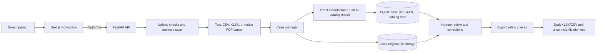

# Production customer onboarding checklist

Use this checklist for each new customer or pilot. Duplicate the **Customer setup record** section for each account. Do not put passwords, API keys, real RFQs, personal information, or customer pricing in this file or in Git.

This checklist is a plan, not a statement that production hosting is already available. The current product is a local prototype. A customer is not ready to use it with live RFQs until every required gate below is completed and evidenced.

## Current product flow

The main UI uses the `/api` routes. A separate `/v1` API has quote-draft approval and simulated-send operations, but it is not the same as the main worksheet workflow. Its quote records are in memory. The RFQ agent is not used by the main intake path. Scanned-PDF OCR is not configured. ERPNext and InvenTree files currently map data structures; they do not connect to those products.

The current API can check API keys and roles when authentication is enabled, but all users still share one case manager, SQLite database, and local file store. That is not customer-to-customer data separation. Local/demo defaults must not be used for live customer RFQs.

## 1. Agree the pilot before receiving files

- [ ] Name the customer owner, day-to-day operator, technical contact, and your support contact.
- [ ] Agree what the pilot will do: component family, RFQ formats, user count, catalog source, and output worksheet.
- [ ] Agree which data the customer may provide and who has permission to share it.
- [ ] Write down what the system will not do: no automatic quote sending, purchasing, technical substitutions, or ERP writes unless separately designed and approved.
- [ ] Agree data location, retention period, deletion process, support hours, and incident contact.
- [ ] Document whether any external service will receive file contents. Do not send customer files to an AI or scanning provider until the provider, purpose, retention, and customer approval are clear.
- [ ] Set pilot success criteria before testing. Include line misses, wrong fields, unflagged critical mistakes, reviewer corrections, source evidence, and review time.

**Gate:** Written scope, data permission, retention, and success criteria are agreed.

## 2. Create a separate customer environment

- [ ] Give the customer a separate environment and data store. Do not rely on an account label inside a shared global database.
- [ ] Add a real sign-in system. Give each person their own account; do not share API keys between people.
- [ ] Set roles for administrators, reviewers, and read-only users. Limit catalog changes and deletion to approved people.
- [ ] Require HTTPS and store secrets in a secret manager. Do not put keys in the frontend bundle, source files, screenshots, or logs.
- [ ] Restrict network access, allowed web origins, upload size, request rates, and admin endpoints.
- [ ] Encrypt stored RFQs, exports, backups, and credentials. Limit service and staff access to the minimum required.
- [ ] Configure malware scanning to fail closed if the scanner is unavailable. Verify the actual scanner and version used.
- [ ] Turn off demo defaults and synthetic sample data. Verify auth is required before any customer data is added.
- [ ] Confirm the app starts with the customer's own settings and cannot load another customer's catalog or files.

**Gate:** A user from another customer cannot see this customer's cases, catalog, files, exports, audit records, or backups. Prove this with automated cross-customer access tests.

## 3. Set up the customer's catalog and quote rules

- [ ] Get the catalog from an authorized customer owner.
- [ ] Agree which columns mean internal SKU, manufacturer, manufacturer part number, description, unit, price, currency, and price date.
- [ ] Reject duplicate or incomplete identifiers and confirm the import does not partially replace a good catalog.
- [ ] Verify sample rows and collision cases with the customer.
- [ ] Set how prices are sourced and dated. Show missing or expired prices as missing; never reuse demo prices as customer prices.
- [ ] Agree the customer's unit names, quote currency, required fields, output template, and draft label.
- [ ] Record who can import a new version, how versions are retained, and what happens to approvals when the catalog changes.

**Gate:** The customer signs off on the imported catalog and sample output. No guessed price, stock, lead time, or technical equivalence is included.

## 4. Prove the whole RFQ workflow with customer-approved samples

For each file format the customer will use, run the same flow from original input to reviewed draft. Keep the original file and expected answer together in the approved test environment.

- [ ] Upload or paste the RFQ and confirm the original is retained under the agreed policy.
- [ ] Compare every extracted line with a human-checked answer: quantity, unit, manufacturer, MPN, description, and source location.
- [ ] Confirm missing or conflicting fields become clear review work, not invented values.
- [ ] Confirm exact matching requires both the right part number and manufacturer.
- [ ] Confirm unknown parts and cross-brand collisions stay unresolved; no similar description is presented as a safe substitute.
- [ ] Edit a line, save it, refresh the browser, and confirm the correction and reviewer are retained.
- [ ] Confirm the audit history shows who changed or approved each line and when.
- [ ] Confirm a normal export is blocked while required fields or decisions are unresolved.
- [ ] If partial drafts are allowed, confirm they remain visibly draft-only and clearly identify unresolved lines.
- [ ] Download the XLSX/CSV and open it in the spreadsheet software the customer uses. Check the values, formulas, draft label, source references, and layout.
- [ ] Confirm the clarification message is only a draft and is not sent.
- [ ] Change the source or catalog after making a quote draft and confirm old approval cannot be reused.

### Required failure and recovery checks

- [ ] Try an unsupported, corrupt, password-protected, empty, oversized, and malformed file.
- [ ] Try an unreadable or scanned PDF. Until OCR is implemented and validated, it must give a clear failure and a manual-entry path; it must not silently produce an empty or complete-looking quote.
- [ ] Interrupt a parse, export, or network request. Confirm the user sees the failure, can retry safely, and does not get duplicate cases or stale download links.
- [ ] Check a file containing formulas, macros, path-like filenames, prompt-injection text, or malformed compressed content.
- [ ] Confirm customer text is treated as data. It must not trigger instructions, tool actions, messages, or external network requests.
- [ ] Check large but allowed documents and multiple files/sheets/pages. Confirm processing has real timeouts and limits.

**Gate:** Every supported sample either produces correct, reviewable rows with source evidence or a clear blocking error and recovery path. No critical mismatch goes unflagged in the agreed test set. Customer reviewers sign off on the results.

## 5. Make processing dependable

These are platform tasks, not one-time customer settings. They must be completed before live use.

- [ ] Run extraction as a tracked job for documents that may take time. Show queued, processing, complete, and failed states based on real work; do not fake progress.
- [ ] Add safe retry and duplicate-submission handling. A retry must not create duplicate cases or overwrite reviewed data.
- [ ] Preserve the original upload if parsing, OCR, a model, or export fails.
- [ ] Set strict file, page, sheet, row, decompression, and processing-time limits.
- [ ] Record parser and catalog versions with each result so a reviewed draft can be reproduced.
- [ ] Add alerts for repeated failures, slow processing, storage problems, and backup failures. Keep logs free of RFQ text, personal details, secrets, and prices.
- [ ] Test restart, restore-from-backup, and recovery after a partial failure.
- [ ] Track and resolve defects found in the customer's agreed test set before expanding scope.

**Current gap:** The main intake path runs synchronously in the API process. It uses deterministic parsers and local storage. Scanned-PDF OCR is not configured. The current corpus proves behavior on synthetic fixtures only; it does not prove performance or accuracy on arbitrary customer files.

## 6. Protect and operate the service

- [ ] Set automated backups and prove a restore works.
- [ ] Set retention and deletion jobs for source files, exports, case data, logs, and backups.
- [ ] Monitor service health, request failures, processing time, storage use, and security alerts without recording sensitive RFQ contents.
- [ ] Prepare support instructions for blocked uploads, missing source files, stuck processing, incorrect extraction, and failed exports.
- [ ] Define who responds to a security incident and how the customer is notified.
- [ ] Keep test, staging, and customer production data separate.
- [ ] Use reviewed releases, dependency updates, vulnerability checks, rollback steps, and a release log.
- [ ] Test keyboard access, screen reader labels, contrast, and readable tables with the customer's normal workstation setup.

**Gate:** The team can detect a failure, explain its effect, restore service/data, and contact the right people.

## 7. Go / no-go review

- [ ] Customer scope and data permission are documented.
- [ ] Separate environment, sign-in, permissions, and customer data boundaries are tested.
- [ ] Catalog, prices, units, and output template are approved by the customer.
- [ ] End-to-end success and failure checks are recorded for every promised input format.
- [ ] No unresolved security, privacy, or unflagged critical extraction issue remains.
- [ ] Backup restore, retention, deletion, and incident response are verified.
- [ ] Customer operators have practiced the workflow and know that every result needs human review.
- [ ] Pilot owner signs off on start date, support path, limits, and stop conditions.

**Decision:** `NOT STARTED / BLOCKED / READY FOR LIMITED PILOT / STOPPED`

**Evidence location:** `[link to approved test results; do not put customer files in this repository]`

## Customer setup record (copy for each customer)

- Customer ID (non-sensitive internal label): `[...]`
- Pilot owner: `[...]`
- Approved data scope / formats: `[...]`
- Environment and region: `[...]`
- Data retention and deletion date: `[...]`
- Catalog owner and version: `[...]`
- Output template and currency: `[...]`
- Approved users and roles (keep details in the access system, not here): `[...]`
- External processors approved: `[...]`
- Test evidence link: `[...]`
- Open blockers / owner / due date: `[...]`
- Go/no-go decision and approver: `[...]`
